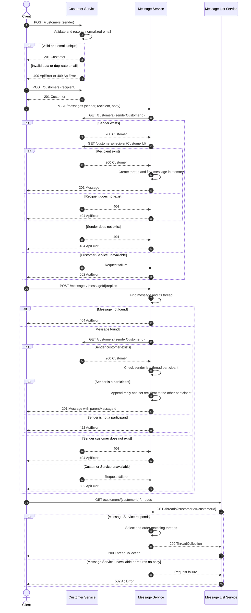
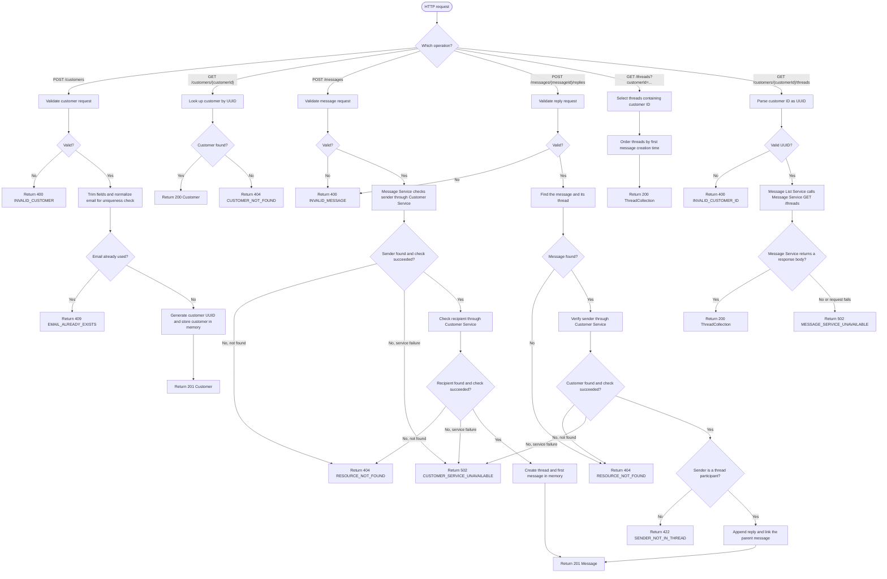

# System Design

## Overview

The application is a synchronous, three-service REST system:

- **Customer Service** owns customer creation and lookup. It keeps customers in process memory.
- **Message Service** validates customer references through Customer Service, owns message threads, and exposes thread lookup. Thread data is held in process memory.
- **Message List Service** exposes a customer-oriented thread-list endpoint and proxies that request to Message Service.

The services are separate Spring Boot applications. Their API interfaces and models are generated from the OpenAPI contracts in this directory using the Spring generator and delegate pattern. There is no database or configured authentication; restarting a service clears its in-memory data.

## Used OpenAPI specifications

The contracts use **OpenAPI 3.0.3** and are the source for each module's generated API interface and model types.

| Specification | Service / generated module | Operations |
| --- | --- | --- |
| [customer-api.yaml](./customer-api.yaml) | Customer Service (`customer-service`) | `POST /customers` creates a customer; `GET /customers/{customerId}` retrieves one by UUID. Customer email addresses are unique, case-insensitively. |
| [message-api.yaml](./message-api.yaml) | Message Service (`message-service`) | `POST /messages` starts a thread; `POST /messages/{messageId}/replies` replies to a message; `GET /threads?customerId={customerId}` lists threads containing a customer. |
| [message-list-api.yaml](./message-list-api.yaml) | Message List Service (`message-list-service`) | `GET /customers/{customerId}/threads` proxies a customer's thread listing. |

The contracts define JSON request/response models for customers, messages, threads, thread collections, and API errors. Their documented error responses include invalid requests, missing resources, duplicate customer email, non-participant replies, and downstream service failures. Request constraints are enforced through the generated Spring API and validation integration; the services map known validation and domain failures to `ApiError` responses. Invalid UUID binding on Message List Service is explicitly mapped to `400 INVALID_CUSTOMER_ID`; other UUID binding failures use Spring's request-binding behavior.

## Mermaid sequence diagram

This sequence shows the main end-to-end path: create two customers, start a thread, reply, and list that customer's threads. The downstream error branches show how service failures are translated to gateway errors.

## Flowchart

## Description per step in the flowchart

1. **HTTP request and route selection** — Spring routes the incoming request to the generated API delegate implemented by the corresponding service. The operation determines the validation, data lookup, and downstream calls that follow.
2. **Validate customer request** — For customer creation, generated request validation checks required fields and contract constraints such as non-empty raw name strings and email format. Names are trimmed afterward, so whitespace-only names can become empty stored values. Invalid input is mapped by Customer Service to `400 INVALID_CUSTOMER`.
3. **Trim and check customer email** — Customer Service trims the customer's names and email, then lowercases the trimmed email with `Locale.ROOT` for a case-insensitive uniqueness key. An already-used key returns `409 EMAIL_ALREADY_EXISTS`.
4. **Create and store customer** — For a unique email, Customer Service generates a UUID, creates the customer, stores it in two concurrent in-memory maps (by UUID and by normalized email), and returns `201 Customer`.
5. **Look up customer** — `GET /customers/{customerId}` reads the in-memory customer map. A match returns `200 Customer`; no match returns `404 CUSTOMER_NOT_FOUND`.
6. **Validate message or reply request** — Message Service applies generated validation constraints, including required customer IDs and a non-empty raw body. The body is not trimmed, so a whitespace-only body satisfies the minimum-length constraint. Invalid content returns `400 INVALID_MESSAGE`.
7. **Verify sender and recipient for a new message** — Before creating a thread, Message Service synchronously calls Customer Service once for the sender and once for the recipient. A customer lookup returning not found maps to `404 RESOURCE_NOT_FOUND`; another customer-service request failure maps to `502 CUSTOMER_SERVICE_UNAVAILABLE`. No thread is stored unless both checks succeed.
8. **Create a thread and first message** — Message Service generates UUIDs for the thread and message, records the two participants, timestamps the message in UTC, stores the thread and its message lookup entry in memory, and returns `201 Message`.
9. **Find a message and thread for a reply** — Message Service resolves the supplied message ID to its thread. If the ID is unknown, it returns `404 RESOURCE_NOT_FOUND`.
10. **Verify reply sender and participation** — Message Service first verifies the sender with Customer Service, then checks that the sender is one of the thread's two participants. A missing customer returns `404 RESOURCE_NOT_FOUND`; a customer-service failure returns `502 CUSTOMER_SERVICE_UNAVAILABLE`; a valid customer outside the thread returns `422 SENDER_NOT_IN_THREAD`.
11. **Append the reply** — The other thread participant becomes the reply recipient. Message Service creates a new UUID and UTC timestamp, sets `parentMessageId` to the message ID in the request, appends the reply to the thread, indexes the reply ID to that thread, and returns `201 Message`.
12. **Select and order threads** — `GET /threads?customerId=...` filters in-memory threads to those containing the requested customer and orders them by the creation time of each thread's first message. It returns `200 ThreadCollection`; an unknown customer ID simply has no matching threads and is not separately checked against Customer Service. Invalid UUID request binding follows Spring's default handling in this service rather than the custom error handler used by Message List Service.
13. **Validate and proxy a thread-list request** — Message List Service parses the path parameter as a UUID; a type mismatch maps to `400 INVALID_CUSTOMER_ID`. It then calls Message Service's `GET /threads` with the customer ID. A returned collection is relayed with `200`; a failed downstream request or empty response body maps to `502 MESSAGE_SERVICE_UNAVAILABLE`.

The in-memory stores are local to each process and are not shared or durable. The service base URLs are configurable: Message Service defaults to Customer Service at `http://localhost:8080`, and Message List Service defaults to Message Service at `http://localhost:8082`.
